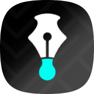

# Nib Color Picker

<p align="center">
  
</p>

<p align="center">
  A fast, private color picker for Windows 10 and Windows 11.
</p>

<p align="center">
  <a href="https://github.com/leo-khani/nib-color-picker/actions/workflows/ci.yml"></a>
  <a href="https://github.com/leo-khani/nib-color-picker/releases"></a>
  <a href="LICENSE"></a>
</p>

Nib Color Picker samples a color anywhere on the Windows desktop, copies it in the
format you need, and keeps a private local history. It is designed as a focused
desktop utility: always available, quick to open, and quiet when it is not being used.

The application is built with React, TypeScript, Tauri 2, and a small Rust layer for
native Windows integration. It does not require an account and does not include
analytics or telemetry.

> [!NOTE]
> Nib is currently in preview. Version `0.1.0` is intended for early adopters and
> contributors. Windows may show a SmartScreen warning until release binaries are
> code-signed.

## Highlights

- Pick a pixel from any connected display with a native Windows picker.
- See the live HEX value in a compact indicator beneath the pointer.
- Confirm with left click; cancel with Escape or right click.
- Launch the picker from a configurable global shortcut.
- Copy HEX, HEX8, RGB, HSL, HSV, HWB, CMYK, decimal, normalized RGB, and Windows BGR.
- Keep a persistent, deduplicated color history with favorites.
- Clear non-favorite history without losing saved colors.
- Generate a lightness scale from the current color.
- Switch to compact mode for a small always-on-top picker window.
- Close to the notification area and reopen from the tray.
- Launch automatically with Windows when enabled.
- Restore the window in a safe visible position after display-layout changes.
- Work entirely offline with locally stored settings and history.

## Install

Download the latest Windows installer from
[GitHub Releases](https://github.com/leo-khani/nib-color-picker/releases).

Two installer formats are produced:

- **NSIS (`.exe`)** — recommended for most users.
- **MSI (`.msi`)** — useful for managed Windows environments.

Nib depends on Microsoft Edge WebView2. The installer can download the WebView2
bootstrapper when the runtime is not already available.

### SmartScreen

Preview releases are not yet code-signed. Windows may display a SmartScreen warning
for an unsigned installer. Verify that the file came from this repository and compare
its SHA-256 hash with the release checksum before running it.

## Usage

1. Open Nib Color Picker.
2. Select **Pick** or press the configured global shortcut.
3. Move the pointer to the color you want.
4. Left-click to select it.
5. Click a displayed format to copy it, or right-click a generated swatch to copy its
   HEX value.

The default shortcut is `Ctrl + Shift + C`. If another application already owns that
combination, choose a different shortcut in Settings.

Closing the window keeps Nib running in the notification area. Use the tray menu's
explicit **Quit** action to exit completely.

## Privacy

Nib does not capture or upload screenshots. The native picker reads the confirmed
pixel directly from the Windows desktop through GDI and releases the device context
immediately afterward.

Settings, favorites, and history remain in the current user's local application-data
directory. Nib makes no runtime network requests and contains no telemetry.

## Development

### Prerequisites

- Windows 10 version 1803 or later, or Windows 11
- Node.js 22 or later
- Rust stable with the `x86_64-pc-windows-msvc` target
- Visual Studio Build Tools with **Desktop development with C++**
- Microsoft Edge WebView2 Runtime

### Run locally

```powershell
git clone https://github.com/leo-khani/nib-color-picker.git
cd nib-color-picker
npm install
npm run tauri:dev
```

`npm run dev` starts the browser-only interface. Native picking, global shortcuts,
tray behavior, startup integration, and window management require
`npm run tauri:dev`.

### Commands

| Command                 | Description                                       |
| ----------------------- | ------------------------------------------------- |
| `npm run dev`           | Start the Vite development server                 |
| `npm run tauri:dev`     | Start the desktop application in development mode |
| `npm run typecheck`     | Run strict TypeScript checks                      |
| `npm run lint`          | Run ESLint                                        |
| `npm run format`        | Format supported project files                    |
| `npm run format:check`  | Check formatting without changing files           |
| `npm run test`          | Run the Vitest suite                              |
| `npm run test:coverage` | Run tests and produce coverage                    |
| `npm run build`         | Build the frontend                                |
| `npm run tauri:build`   | Build Windows installers                          |
| `npm run validate`      | Run the complete frontend validation pipeline     |

Rust checks run from the repository root:

```powershell
cargo fmt --manifest-path src-tauri/Cargo.toml --check
cargo clippy --manifest-path src-tauri/Cargo.toml --all-targets --all-features -- -D warnings
cargo test --manifest-path src-tauri/Cargo.toml --all-targets --all-features
```

## Build installers

```powershell
npm ci
npm run tauri:build
```

Tauri writes release artifacts beneath:

```text
src-tauri/target/release/bundle/
  msi/
  nsis/
```

The build version is shared by `src-tauri/tauri.conf.json` and
`src-tauri/Cargo.toml`. Update both files before creating a version tag.

## Architecture

```text
src/
  app/                         Application shell and lifecycle
  components/                  Shared interface components
  features/
    color-details/             Current color and formats
    color-harmonies/           Generated color variations
    color-history/             History and favorites
    settings/                  Application preferences
  lib/
    color/                     Parsing, conversion, and contrast math
    storage/                   Validation and migrations
  stores/                      Durable application state

src-tauri/src/
  lib.rs                       Tauri setup, tray, shortcuts, and commands
  picker/                      Native Windows sampling and pointer indicator
```

React owns the interface and durable user state. Rust is limited to work that needs
native Windows APIs: desktop pixel sampling, global input handling, tray integration,
and window behavior. High-frequency picker state stays outside React.

Architectural decisions are documented in:

- [ADR 0001: Native Windows picker](docs/adr/0001-native-picker.md)
- [ADR 0002: Local storage](docs/adr/0002-local-storage.md)

## Releases

Tags matching `v*` trigger the Windows release workflow. The workflow validates the
project, builds NSIS and MSI installers, generates SHA-256 checksums, and creates a
draft GitHub release.

To prepare a release:

1. Update the version in `src-tauri/tauri.conf.json` and `src-tauri/Cargo.toml`.
2. Move completed entries from **Unreleased** into a dated section in
   [CHANGELOG.md](CHANGELOG.md).
3. Commit the release changes.
4. Create and push an annotated tag such as `v0.1.0`.
5. Review the draft GitHub release and its artifacts.
6. Publish the release after installer smoke testing.

## Current limitations

- Windows installers are not yet code-signed.
- Automatic application updates are not enabled.
- The current native indicator shows the selected color and HEX value but does not
  include a magnified neighboring-pixel grid.
- Mixed-DPI, fullscreen, sleep/wake, and unusual multi-monitor arrangements still
  need broader hardware testing.

## Contributing

Contributions are welcome. Read [CONTRIBUTING.md](CONTRIBUTING.md) before opening a
pull request, and use the issue templates for reproducible bug reports and focused
feature proposals.

By participating, you agree to follow the [Code of Conduct](CODE_OF_CONDUCT.md).
Security issues must be reported privately according to [SECURITY.md](SECURITY.md).

## License

Nib Color Picker is released under the [MIT License](LICENSE).
